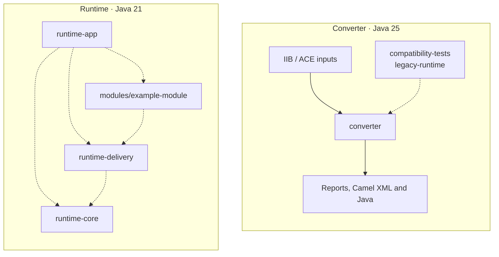

# iib-camel

A repository with an IIB/ACE analysis and supported-subset conversion tool, plus an independent Spring Boot and Apache
Camel runtime for manually migrated integrations.

> [Русская версия](README.ru.md)

## What it does

The `analyze` command reads `.msgflow`, `.subflow`, and `.esql` inputs. It writes flow diagrams and reports, plus an ESQL module inventory when ESQL is present. The `convert` command generates Camel XML routes, Java beans for the supported ESQL subset, and a conversion report.

The ESQL profile supports a limited set of Compute `Main` functions, including selected `SET` operations, conditional branches, expressions, and explicit casts. Unsupported or incomplete ESQL is reported and its generated bean stops before running business operations. The converter also generates models for a subset of XSD and JSON Schema and MapStruct processors for simple same-type XMLNSC field moves in IBM `.map` files. These features do not cover full ESQL, ULM, or IBM Mapping semantics. `convert` applies a strict readiness gate by default; unsupported or ambiguous project features need review before using generated routes. See [implementation progress](docs/implementation-progress.ru.md), the [pilot profile](docs/pilot-profile.ru.md), and the [deployment guide](deploy/README.ru.md) for the supported limits and required runtime checks.

This is an experimental migration aid, not a complete IIB/ACE parser or a production migration service. Generated output must be reviewed and validated against the source application and target environment. The converter and integration runtime are independent Maven projects with separate JDK requirements; the runtime is not the legacy execution environment used by compatibility tests.

## Architecture

The repository contains two independent projects. The Java 25 converter analyzes IIB/ACE inputs and generates artifacts
for a supported subset. The Java 21 runtime is a separate Spring Boot and Camel application for manually assembled
integrations; generated converter output is not loaded into it automatically. Business behavior, including ESQL
transformations, must be reviewed and implemented in runtime modules. The example module only passes message bytes
through.

The root Maven reactor includes the converter, runtime, and compatibility-test projects. The runtime also has its own
parent POM and reactor under `runtime/`, which sets its Java 21 compiler target and manages its modules.

| Module                                | Responsibility                                                                            |
|---------------------------------------|-------------------------------------------------------------------------------------------|
| `converter/`                          | Java 25 CLI for IIB/ACE analysis and supported-subset conversion.                         |
| `runtime/runtime-core/`               | Java 21 Camel transports, XML support, and message envelopes.                             |
| `runtime/runtime-delivery/`           | PostgreSQL inbox/outbox delivery services and persistence.                                |
| `runtime/modules/example-module/`     | Example Java handler and manually authored Camel XML route; passes payload bytes through. |
| `runtime/runtime-app/`                | Boot executable that wires the runtime libraries and integration modules.                 |
| `compatibility-tests/legacy-runtime/` | Java 25 test-only environment for generated-artifact converter regression tests.          |
| `examples/analyze/`, `docs/`          | Illustrative analysis inputs, requirements, and migration guidance.                       |



Dashed arrows show Maven dependencies. The converter and runtime have no dependency or automatic artifact handoff
between them. See the [runtime guide](runtime/README.ru.md) for its module model, configuration, delivery behavior, and
startup instructions.

## Build

Requirements: Maven 3.9 or newer, JDK 25 for the converter and compatibility tests, and JDK 21 for the runtime.

Build the converter and its legacy compatibility tests from the repository root:

```sh
mvn -B -f pom.xml -pl converter,compatibility-tests/legacy-runtime -am verify
```

Build the independent runtime from its own parent project:

```sh
mvn -B -f runtime/pom.xml verify
```

The converter JAR is created at `converter/target/converter.jar`. Runtime requirements, startup, offline operation, PostgreSQL delivery, and transport settings are described in [runtime documentation](runtime/README.ru.md).

## CLI examples

Inventory queues/topics and flow links from `.msgflow`/`.subflow`, keeping ESQL as opaque handler references:

```sh
java -jar converter/target/converter.jar analyze --inventory \
  --input examples/analyze/inventory --output output/inventory
```

Start with `system-overview.md`; CSV, JSON, and individual flow reports are written alongside it.
[Example and analysis limitations (RU)](examples/analyze/inventory/README.ru.md).

Analyze the included demonstration inputs and write Mermaid, AsciiDoc, and Markdown reports:

```sh
java -jar converter/target/converter.jar analyze \
  --input examples/analyze/system \
  --output target/manual-analysis \
  --format all
```

Convert the included test corpus to Camel XML and Java output:

```sh
java -jar converter/target/converter.jar convert \
  --input converter/src/test/resources/corpus \
  --output target/converted
```

Generated artifacts are written to the selected output directory. Review the command report and any unsupported-operation diagnostics before using the results.

## Documentation

- [Functional requirements](docs/functional-requirements.en.md)
- [Testing strategy](docs/test-strategy.en.md)
- [Implementation progress (RU)](docs/implementation-progress.ru.md)
- [Manual analysis examples (RU)](examples/analyze/README.ru.md)

## License

This project is licensed under the [Apache License, Version 2.0](LICENSE). See [NOTICE](NOTICE) for attribution information.
