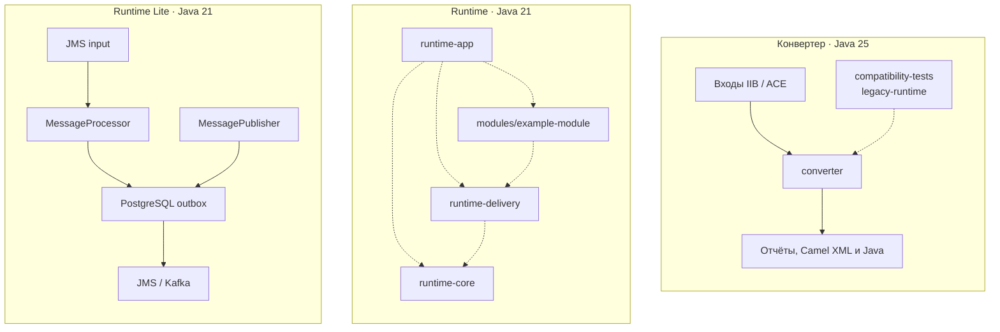

# iib-camel

Репозиторий объединяет инструмент анализа потоков IBM Integration Bus (IIB/ACE) и конвертации поддерживаемого
подмножества, а также самостоятельный Spring Boot и Apache Camel runtime для интеграций, переносимых вручную.

> [English version](README.md)

## Возможности

Команда `analyze` читает `.msgflow`, `.subflow` и `.esql`, создаёт диаграммы и отчёты по потокам, а при наличии ESQL — инвентарь модулей. Команда `convert` генерирует XML-маршруты Camel, Java-бины для поддерживаемого подмножества ESQL и отчёт о конвертации.

Подмножество ESQL ограничено: поддерживаются отдельные функции Compute `Main`, операции `SET`, условные ветви и выражения с явными преобразованиями типов. Неподдерживаемый или неполный ESQL отмечается в отчёте; сгенерированный бин останавливается до выполнения бизнес-операций. Для подмножеств XSD и JSON Schema генерируются модели; простые перемещения однотипных XMLNSC-полей из IBM `.map` генерируются как MapStruct-мапперы и runtime-процессоры. Это не полная поддержка ESQL, ULM или IBM Mapping. Команда `convert` по умолчанию включает строгую проверку готовности пакета. Подробности и ограничения приведены в документе [ход реализации](docs/implementation-progress.ru.md), [профиле пилота](docs/pilot-profile.ru.md) и [руководстве по развёртыванию](deploy/README.ru.md).

Это экспериментальный инструмент миграции, а не полный парсер IIB/ACE и не промышленный сервис миграции. Результаты нужно проверить относительно исходного приложения и целевой среды. Конвертер и runtime — независимые Maven-проекты с разными требованиями к JDK. Устаревший runtime сохранён только для compatibility-тестов.

## Архитектура

В репозитории находятся независимые проекты. Конвертер на Java 25 анализирует входы IIB/ACE и генерирует артефакты
для поддерживаемого подмножества. Полный runtime на Java 21 использует Spring Boot и Camel; отдельный `runtime-lite` на
Java 21 реализует JMS-вход, Java-обработчики и PostgreSQL outbox с JMS/Kafka-выходами без Camel. Ни один runtime не
загружает результат конвертера автоматически. Бизнес-поведение нужно проверить и реализовать в Java-модулях.

Корневой Maven reactor включает конвертер, runtime, runtime-lite и проект compatibility-тестов. У runtime также есть собственный
родительский POM и reactor в каталоге `runtime/`, который задаёт требования к Java 21 и управляет модулями.

| Модуль                                | Ответственность                                                                                         |
|---------------------------------------|---------------------------------------------------------------------------------------------------------|
| `converter/`                          | CLI на Java 25 для анализа IIB/ACE и конвертации поддерживаемого подмножества.                          |
| `runtime/runtime-core/`               | Camel-транспорты, поддержка XML и конверты сообщений на Java 21.                                        |
| `runtime/runtime-delivery/`           | Сервисы и хранение inbox/outbox в PostgreSQL.                                                           |
| `runtime/modules/example-module/`     | Пример Java-обработчика и вручную заданного Camel XML-маршрута; передаёт байты сообщения без изменений. |
| `runtime/runtime-app/`                | Исполняемое приложение Boot, связывающее библиотеки runtime и модули интеграций.                        |
| `runtime-lite/`                       | Самостоятельный Spring Boot JMS runtime с inbox/outbox и выходами JMS/Kafka.                              |
| `compatibility-tests/legacy-runtime/` | Тестовое окружение на Java 25 только для регрессионных проверок артефактов конвертера.                  |
| `examples/analyze/`, `docs/`          | Иллюстративные входы для анализа, требования и руководство по миграции.                                 |



Пунктирные стрелки показывают Maven-зависимости внутри полного runtime. Runtime Lite и конвертер собираются независимо;
автоматической передачи артефактов между ними нет. Описание полного runtime, настроек, доставки и запуска приведено
в [руководстве runtime](runtime/README.ru.md).

Runtime Lite имеет отдельное [краткое руководство](runtime-lite/README.ru.md), включая объявление обработчика,
конфигурацию, сборку и границы доставки.

## Сборка

Требуются Maven 3.9 или новее, JDK 25 для конвертера и compatibility-тестов, JDK 21 для runtime и runtime-lite.

Собрать конвертер и compatibility-тесты legacy runtime из корня репозитория:

```sh
mvn -B -f pom.xml -pl converter,compatibility-tests/legacy-runtime -am verify
```

Собрать самостоятельный runtime:

```sh
mvn -B -f runtime/pom.xml verify
```

Собрать JMS Runtime Lite независимо:

```sh
mvn -B -f runtime-lite/pom.xml verify
```

Сборка создаёт JAR конвертера `converter/target/converter.jar`. Требования к новому runtime, запуск, offline-режим, доставка через PostgreSQL и настройки транспортов описаны в [руководстве runtime](runtime/README.ru.md).

## Примеры CLI

Составить каталог очередей/топиков и карту связей по `.msgflow`/`.subflow`, сохранив ESQL как ссылки на обработчики:

```sh
java -jar converter/target/converter.jar analyze --inventory \
  --input examples/analyze/inventory --output output/inventory
```

Начальная страница — `system-overview.md`; рядом CSV, JSON и карточки потоков.
[Состав примера и ограничения анализа](examples/analyze/inventory/README.ru.md).

Проанализировать демонстрационные входы и создать отчёты Mermaid, AsciiDoc и Markdown:

```sh
java -jar converter/target/converter.jar analyze \
  --input examples/analyze/system \
  --output target/manual-analysis \
  --format all
```

Конвертировать тестовый корпус в XML-маршруты Camel и Java:

```sh
java -jar converter/target/converter.jar convert \
  --input converter/src/test/resources/corpus \
  --output target/converted
```

Результаты записываются в выбранный каталог. Перед использованием изучите отчёт и диагностику неподдерживаемых операций.

## Документация

- [Функциональные требования](docs/functional-requirements.ru.md)
- [Стратегия тестирования](docs/test-strategy.ru.md)
- [Ход реализации](docs/implementation-progress.ru.md)
- [Runtime Lite](runtime-lite/README.ru.md)
- [Ручная проверка анализа](examples/analyze/README.ru.md)

## Лицензия

Проект распространяется по [Apache License, Version 2.0](LICENSE). Информация об атрибуции приведена в [NOTICE](NOTICE).
