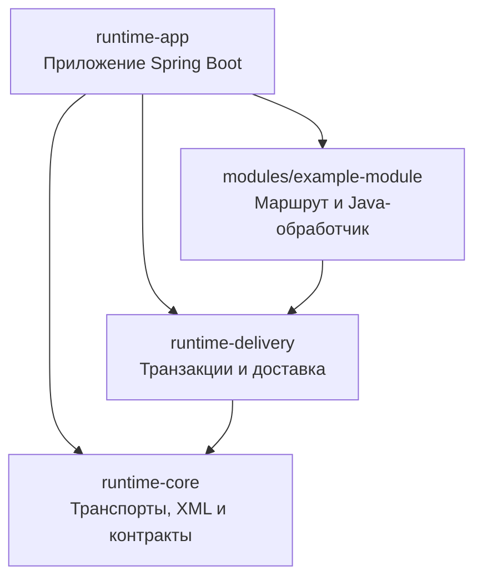
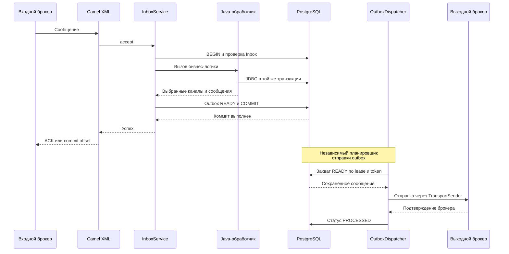

# Runtime интеграций

Автономное приложение для запуска подключаемых интеграций на Spring Boot и Apache Camel. Каталог `runtime/` собирается отдельно от конвертера; конкретный модуль интеграции подключается как Maven-зависимость приложения и содержит собственные Camel XML-маршруты.

## Архитектура

Runtime состоит из библиотек и одного исполняемого Spring Boot приложения. Все подключённые модули интеграций работают в
одном JVM-процессе; каталог модуля не означает отдельный сервис. Конвертер не требуется для сборки или запуска runtime:
маршруты и Java-обработчики модулей реализуются вручную.

| Модуль                                            | Ответственность                                                                                                                                             |
|---------------------------------------------------|-------------------------------------------------------------------------------------------------------------------------------------------------------------|
| `pom.xml`                                         | Родительский POM и Maven reactor runtime: Java 21, BOM, версии зависимостей и процессоры аннотаций                                                          |
| `runtime-core`                                    | Контракты сообщений и `TransportSender`, Camel-компоненты IBM MQ/Artemis/Kafka, отправители, Jackson XML и настройки соединений                             |
| [runtime-delivery](runtime-delivery/README.ru.md) | PostgreSQL inbox/outbox, дедупликация входа, транзакции бизнес-обработки, захват исходящих записей, планировщик и повторы отправки; миграции Liquibase      |
| `modules/example-module`                          | Минимальная интеграция: собственный Camel XML-маршрут, Java-обработчик, типизированные параметры и тесты. Передаёт исходные байты без бизнес-преобразования |
| `runtime-app`                                     | Точка запуска Spring Boot, подключение библиотек модулей, загрузка их XML-маршрутов, YAML-профили, Actuator и исполняемый JAR                               |

Схема показывает зависимости Maven: стрелка направлена от модуля к его зависимости. Родительский POM управляет их
сборкой и сам не исполняется.



### Как проходит сообщение

Camel отвечает за входной канал и последовательность вызовов. Java-обработчик модуля выполняет бизнес-логику, читает
справочники и выбирает исходящие каналы. `runtime-delivery` объединяет обработку и запись выходов в транзакцию
PostgreSQL, а транспортный отправитель публикует сохранённые сообщения позже.



Показан успешный путь нового сообщения. Повторный вход отсекает inbox; ошибка обработки откатывает транзакцию БД и
возвращается потребителю без подтверждения. После коммита БД вход уже можно подтвердить: сообщение для отправки
сохранено независимо от доступности выходного брокера. Сбой между подтверждением отправки и записью `PROCESSED`
допускает дубликат с тем же `applicationEventId`, поэтому принимающей стороне нужна дедупликация.

### Где размещать свою интеграцию

Каждый новый модуль располагается в `modules/<module-name>/` и содержит Java-обработчики, XML-маршруты, параметры, тесты
и README с контрактом интеграции. Его JAR подключается зависимостью в `runtime-app`, а Spring AutoConfiguration
регистрирует обработчики и `IntegrationModule` с путём XML-ресурсов. Приложение загружает маршруты только включённых
модулей. Добавление модуля требует пересборки и перезапуска приложения.

Общий код подключения брокеров и доставки остаётся в `runtime-core` и `runtime-delivery`. В модуле задаются
бизнес-преобразования и решения маршрутизации; JDBC-операции внутри `InboxService.accept` используют тот же
`DataSource`, чтобы вход, бизнес-данные и выходы фиксировались атомарно. Планировщик outbox отправляет уже
подготовленные сообщения и повторно бизнес-логику не запускает.

Полный пример структуры, регистрации и конфигурации приведён в [шаблоне модуля](docs/module-template.ru.md), границы
транзакций — в [контракте доставки](docs/delivery.ru.md). Конфиденциальные исходники и документация конкретных
бизнес-модулей в публичный репозиторий не входят.

## Требования

- JDK 21 и Maven 3.9 или новее.
- Docker Compose для локальных PostgreSQL и выбранного транспорта.
- PostgreSQL для надёжного inbox/outbox режима. Версия для стенда: `postgres:18-alpine`.

Runtime использует Spring Boot 4.1.2, Apache Camel 4.22.2 LTS и Jackson 3. Версии и набор зависимостей закреплены в родительском POM runtime.

Конфигурация приложения находится в `runtime-app/src/main/resources/application.yaml`, профиль без внешних сервисов — в
`application-offline.yaml`. Настройки транспорта, доставки и модулей связываются через `@ConfigurationProperties`;
инфраструктура JDBC/Hikari использует стандартные классы настроек Spring Boot. Lombok генерирует обычные аксессоры, а
`spring-boot-configuration-processor` формирует метаданные для подсказок IDE в YAML. Версия Lombok также управляется
Spring Boot BOM.

## Сборка и запуск

Из каталога `runtime/`:

```bash
mvn -B verify
cp deploy/.env.example deploy/.env
docker compose --env-file deploy/.env -f deploy/compose.yaml up -d postgres
set -a
. deploy/.env
set +a
java -jar runtime-app/target/iib-camel-runtime-app-0.0.1-SNAPSHOT.jar
```

Выберите профиль транспорта и передайте его Compose при запуске. Приложение, запущенное на хосте, подключается к опубликованным на loopback портам:

```bash
docker compose --env-file deploy/.env -f deploy/compose.yaml --profile artemis up -d
# либо --profile kafka, либо --profile ibm-mq
```

Собранный исполняемый файл находится в `runtime-app/target/iib-camel-runtime-app-0.0.1-SNAPSHOT.jar`. Он запускается на Java 21. Для проверки без БД и брокеров используйте `--spring.profiles.active=offline`. Файл `deploy/.env` локальный и игнорируется Git. Docker-образ собирается из этого же каталога командой `docker build -t integration-runtime:local .`; адреса подключений при запуске образа должны быть доступны из его контейнерной сети.

## Подключение транспорта

Входящие коннекторы включаются независимо флагами `IIB_TRANSPORTS_ARTEMIS_ENABLED`, `IIB_TRANSPORTS_IBMMQ_ENABLED` и `IIB_TRANSPORTS_KAFKA_ENABLED`; каждый по умолчанию выключен. Приложение регистрирует Camel-компоненты `artemis`, `ibmmq` и `kafka`, поэтому маршруты могут обращаться к нескольким включённым брокерам одновременно, например:

```xml
<routes xmlns="http://camel.apache.org/schema/spring">
  <route id="example.artemis" errorHandlerRef="runtimePropagateErrors">
    <from uri="artemis:queue:INPUT.ARTEMIS"/>
    <process ref="exampleReceive"/>
  </route>
  <route id="example.ibmmq" errorHandlerRef="runtimePropagateErrors">
    <from uri="ibmmq:queue:INPUT.MQ"/>
    <process ref="exampleReceive"/>
  </route>
  <route id="example.kafka" errorHandlerRef="runtimePropagateErrors">
    <from uri="kafka:INPUT.KAFKA?groupId=example-runtime"/>
    <process ref="exampleReceive"/>
  </route>
</routes>
```

Это примеры URI для отдельных Camel-маршрутов. Встроенный примерный модуль задаёт один вход URI свойством `IIB_MODULE_EXAMPLE_INPUT_URI`; чтобы читать несколько источников в нём одновременно, добавьте маршрут для каждого источника. Artemis использует `IIB_TRANSPORTS_ARTEMIS_BROKER_URL`, `..._USERNAME` и `..._PASSWORD`. IBM MQ использует `IIB_TRANSPORTS_IBMMQ_HOST`, `..._PORT`, `..._QUEUE_MANAGER`, `..._CHANNEL`, `..._USERNAME` и `..._PASSWORD`. Kafka использует `IIB_TRANSPORTS_KAFKA_BOOTSTRAP_SERVERS`. Дополнительные параметры безопасности приведены в [справочнике подключений](docs/connections.ru.md).

Inbox/outbox включён в приложении по умолчанию; флаг `IIB_DELIVERY_ENABLED` управляет самой функцией, а `IIB_DELIVERY_PUBLISHER_ENABLED` — единственный opt-in для запуска периодического отправителя. Пакет, число попыток, lease и начальная задержка повтора настраиваются через `IIB_DELIVERY_BATCH_SIZE`, `IIB_DELIVERY_MAX_ATTEMPTS`, `IIB_DELIVERY_LEASE` и `IIB_DELIVERY_BACKOFF`. Повтор использует экспоненциальный backoff. `IIB_DELIVERY_FIXED_DELAY` настраивает паузу планировщика.

Inbox/outbox обеспечивает атомарную запись принятого сообщения и его выходного события в транзакции PostgreSQL. После фиксации входной транзакции входное сообщение подтверждается брокеру. Отдельный отправитель захватывает готовую запись lease-ом и отмечает её `PROCESSED` после того, как брокер принял отправку. Сбой между принятием сообщения брокером и фиксацией `PROCESSED` в базе может привести к повторной отправке; повтор сохраняет тот же `eventId`, а принимающая сторона должна дедуплицировать события. Протокол не использует распределённую XA-транзакцию и не обещает доставку ровно один раз.

Liquibase changelog находится в `runtime-delivery/src/main/resources/db/changelog/db.changelog-master.yaml`. Параметр
`IIB_DELIVERY_SCHEMA` задаёт схему таблиц доставки и Liquibase; значение по умолчанию — `public`. Для существующей базы
с таблицами и историей Flyway нужна отдельно подготовленная и проверенная baseline-миграция Liquibase: история не
импортируется автоматически, а запуск без baseline должен завершиться ошибкой. `IIB_DELIVERY_CREATE_SCHEMA` включает
создание схемы перед миграцией и выключен по умолчанию; для локального окружения пример включает его. Приложение
получает настройки JDBC через `IIB_POSTGRES_URL`, `IIB_POSTGRES_USER` и `IIB_POSTGRES_PASSWORD`.

Подробности транзакций, повторов, lease и эксплуатационных ограничений описаны в [контракте доставки](docs/delivery.ru.md). Поддержка брокеров проверяется отдельно от их TLS-настроек; перед подключением к защищённому окружению требуется проверка его сертификатов и авторизации.

## Разработка модуля интеграции

Скопируйте [шаблон модуля](docs/module-template.ru.md), задайте уникальный идентификатор в нижнем регистре с дефисами и зарегистрируйте новый Maven-каталог в агрегаторе. Добавьте зависимость на модуль в `runtime-app/pom.xml`, настройте его свойства и соберите приложение заново. Модули подключаются на этапе сборки; горячая загрузка JAR не поддерживается.

Каждый модуль должен документировать источники и назначения, настройки, форматы сообщений, правила повторов и дедупликации, а также ограничения эксплуатации. Входные данные и примеры должны быть синтетическими. Материалы с реальными источниками, организациями или бизнес-данными храните только вне репозитория либо в игнорируемом `.private/`.

## Профили Compose

`postgres` запускается без профиля. Artemis, Kafka и IBM MQ включаются профилями `artemis`, `kafka` и `ibm-mq`. Все опубликованные порты привязаны к `127.0.0.1`; хостовые порты отличаются от стандартных портов существующих сервисов разработчика.

IBM MQ предоставлен только как необязательный локальный сервис. Образ требует принять лицензионные условия IBM: задайте `IBM_MQ_LICENSE_ACCEPT=accept` в локальном `deploy/.env` только после их принятия. Без этого образ не должен успешно запуститься. Образ для этого сервиса предназначен для `linux/amd64`.
